# MomBTI — 근거 기반 다이어트 리포트

> 4개 입력으로 "얼마나 먹어야 하는지"와 "언제쯤 목표에 닿는지"를 논문 공식으로 계산해 보여주는 모바일 앱 (웹 + WebView)

| 항목 | 내용 |
|---|---|
| 기간 | 2026.10 ~ (1차 MVP) |
| 역할 | 기획, 설계, 백엔드, 프론트엔드, 문서 (1인) |
| 스택 | Java 21, Spring Boot 4.1, Thymeleaf, Chart.js 4.4, JUnit 5 |
| 규모 | 소스 80파일, 테스트 32파일·300개, 엣지 케이스 30개 전부 테스트, ADR 27건 |
| 배포 | 웹 + 모바일 앱(WebView) |

  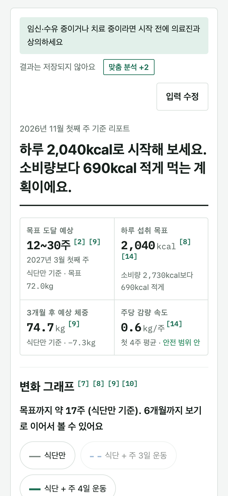
  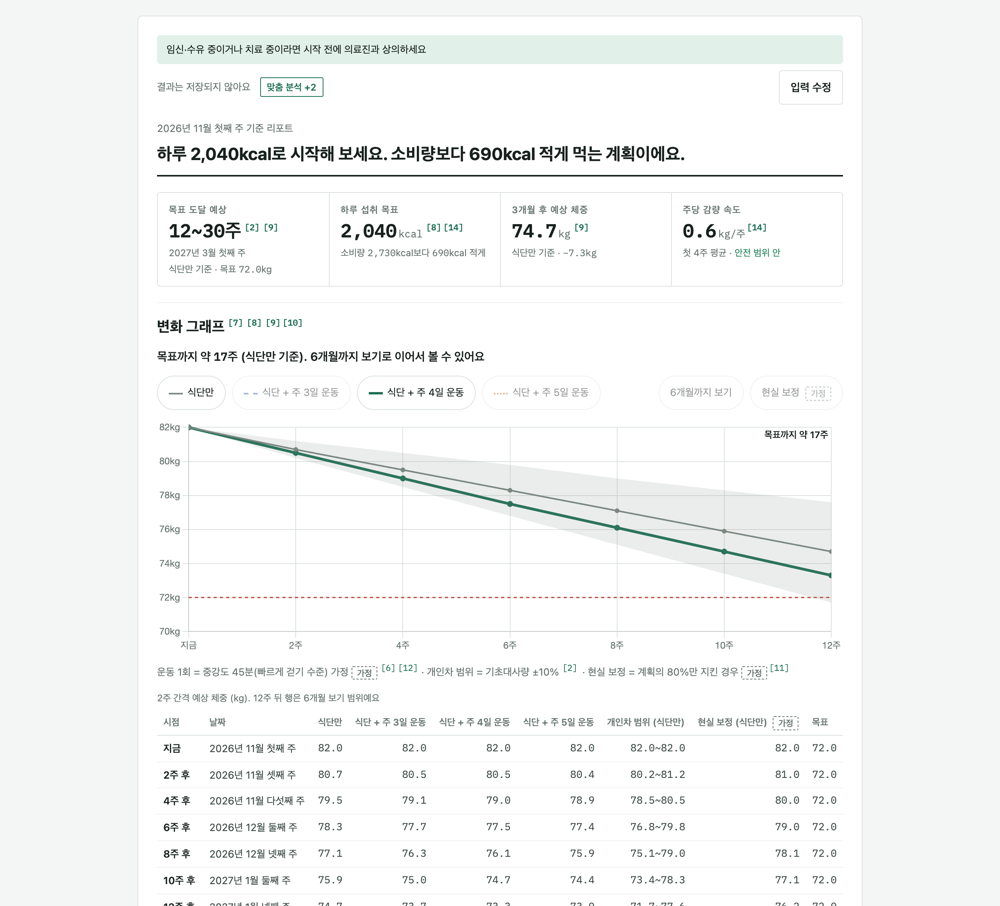

## 1. 문제
- 다이어트 계산기는 대부분 "7,700kcal = 1kg" 단순 규칙을 써서 예측이 지나치게 낙관적이다.
- 입력 항목이 많으면 시작하기 전에 지친다. 그렇다고 입력이 적으면 결과가 대충이 된다.
- 숫자에 근거가 없어서 믿을지 말지 판단할 수 없다.

## 2. 해결 방향
1. **최소 입력, 완전한 결과**: 필수 4개만 받고, 나머지는 근거 있는 기본값으로 채워 "추정" 태그를 붙인다.
2. **근거가 있는 숫자만**: 모든 공식과 상수를 논문(PMID)과 1:1로 연결하고, 원문 대조를 마친 것만 코드에 쓴다.
3. **변화가 보이게**: 12주 그래프를 2주 간격으로 보여줘서 초반 변화가 크게 보이도록 한다.

## 3. 주요 화면
| 입력 | 요약 카드 | 변화 그래프 |
|---|---|---|
| 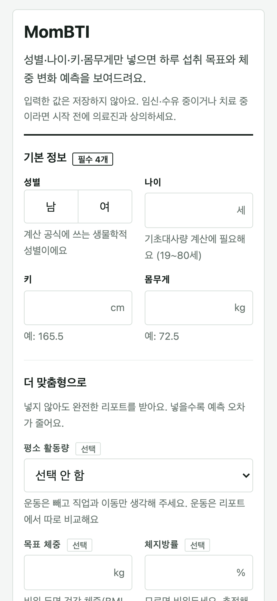 |  | 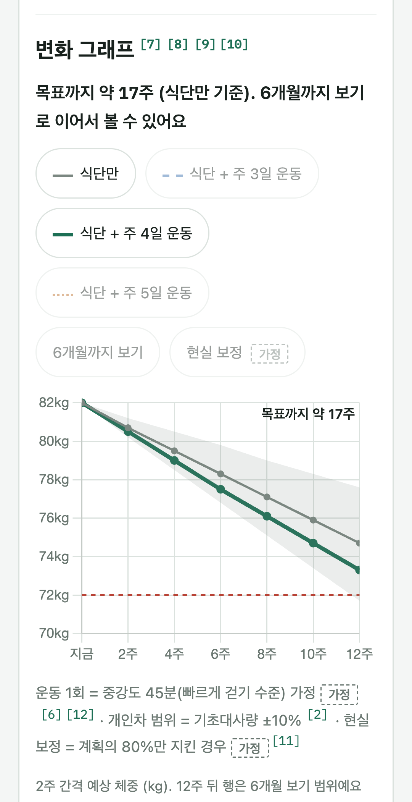 |

| 도달 예측 (모바일 카드) | 식단 | 근거 목록 |
|---|---|---|
| 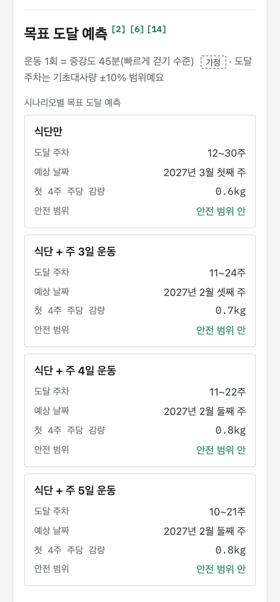 | 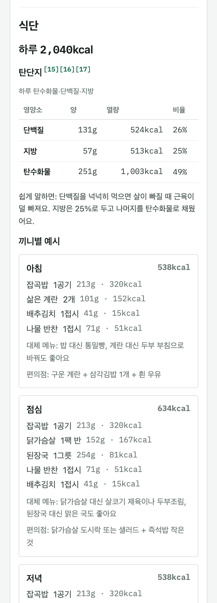 | 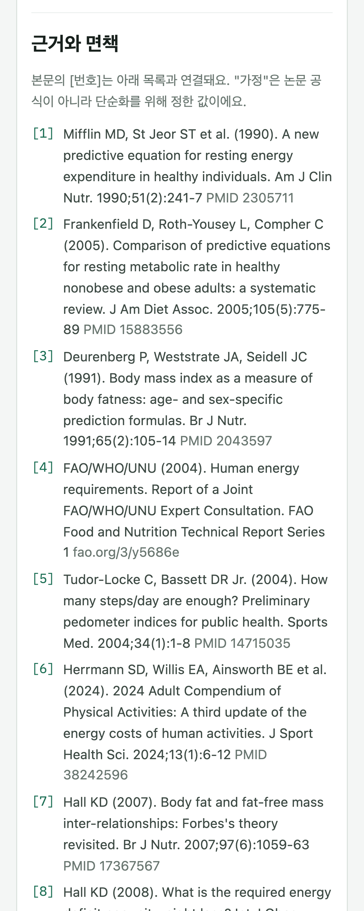 |

| 다크모드 입력 | 다크모드 요약 |
|---|---|
| 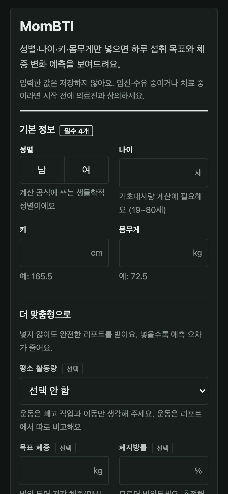 | 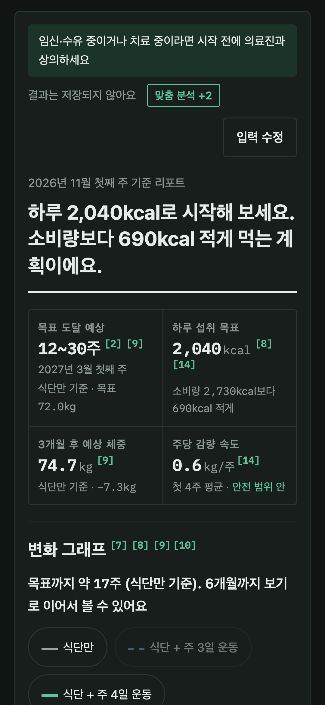 |

| 웹 라이트 | 웹 다크 |
|---|---|
|  | 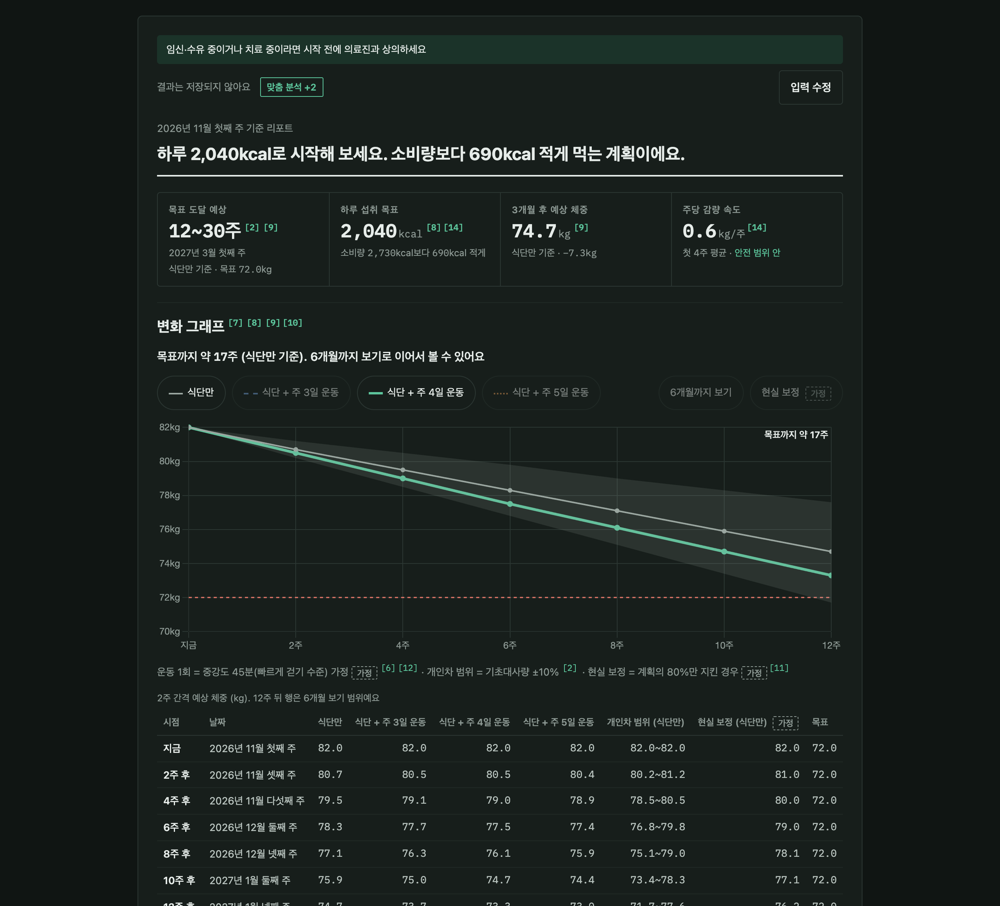 |

6개월 보기를 켜면 목표 도달 지점이 그래프에 표시된다.

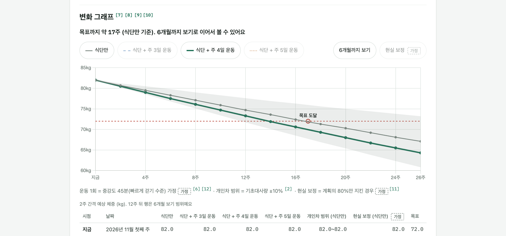

## 4. 계산 엔진
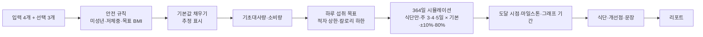

| 단계 | 공식 | 출처 |
|---|---|---|
| 기초대사량 | Mifflin-St Jeor / 체지방률 입력 시 Cunningham | Mifflin 1990, Cunningham 1991 |
| 체지방률 추정 | Deurenberg (BMI·나이·성별) | Deurenberg 1991 |
| 활동계수 | PAL 1.40~2.00 | FAO/WHO/UNU 2004 |
| 운동 | MET 4.8 × 45분 (가정) | 2024 Adult Compendium |
| 체중 변화 | 하루 단위 에너지 밸런스 + Forbes 분배 | Hall 2007·2008·2011 |
| 안전 규칙 | 주당 체중 1% 이하, 칼로리 하한 여 1,200 / 남 1,500 | Helms 2014, AHA/ACC/TOS 2013 |

- 도달 시점은 기초대사량 ±10%로 세 번 시뮬레이션해 "12~30주"처럼 범위로 보여준다.
- 공식의 오차를 숨기지 않는 것이 과신을 막는다고 판단했다.

## 5. 기술 선택과 트레이드오프
### 5-1. 규칙 기반 vs LLM
- **선택**: 규칙 기반. 조언 문장 생성부만 인터페이스(`AdviceNarrator`)로 분리해 2차에 LLM을 붙일 수 있게 했다.
- **이유**: LLM은 숫자를 만들거나 없는 논문을 인용할 위험이 있다. 규칙 기반은 같은 입력에 같은 결과를 내고, 단위 테스트로 검증할 수 있다.
- **포기**: "야근이 많고 무릎이 안 좋아요" 같은 자유 텍스트 해석.
- 비교 문서: [REPORT_STRATEGY.md](docs/REPORT_STRATEGY.md)

### 5-2. 정적 규칙 vs 동적 체중모델
- **선택**: Hall 동적 모델 단순화판. 매일 체중에 맞춰 기초대사량을 다시 계산하고, 지방·제지방 비율을 나눈다.
- **포기**: 구현과 테스트가 복잡해진다. 다른 계산기보다 감량이 느려 보인다. 그래서 FAQ에 "왜 느리게 빠지나요"를 넣었다.
- **검증**: "같은 적자에서 7,700kcal 규칙보다 감량이 느리다"를 속성 테스트로 고정했다.

### 5-3. 입력을 얼마나 받을 것인가
- 처음 기획에는 수면, 외식·음주, 운동 경험·장소, 부상, 식이 제한까지 받는 상세 입력이 있었다.
- 데모를 직접 보니 추가 입력이 필수처럼 느껴졌고, 결과물도 예상보다 많았다. 그래서 필수 4개, 선택 3개(활동량, 목표 체중, 체지방률)만 남겼다.
- 운동 루틴, 복부 지표, 목표 날짜도 뺐다. 사람마다 운동 강도와 체감이 달라서 일괄 루틴은 맞지 않는다고 봤다.
- 운동은 빈도별 결과 비교만 남기고, 1회 운동은 "중강도 45분"으로 가정해 표시했다.
- 뺀 기능은 [BACKLOG.md](docs/BACKLOG.md)에 이유와 함께 남겼다.

| | 처음 기획 | 최종 (MVP) |
|---|---|---|
| 입력 | 필수 3 + 상세 10여 개 | 필수 4 + 선택 3 |
| 운동 | 주간 루틴, 운동 목록 | 빈도별 결과 비교만 |
| 그래프 | 목표 날짜까지 | 기본 12주 + 6개월 토글 |
| 개선할 부분 | 요약 카드에 포함 | 리포트 하단 |

### 5-4. 근거 검증에서 바뀐 것
구현 전에 모든 출처를 PubMed 원문과 대조했다.

| 항목 | 처음 | 검증 후 |
|---|---|---|
| 운동 MET | 4.3 (2011판) | **4.8** (2024 개정판, 최신 우선) |
| 제지방 기반 BMR 출처 | Katch-McArdle 교과서 | Cunningham 1991 (원 출처) |
| 칼로리 하한 출처 | NHLBI 1998 (원문 확인 불가) | AHA/ACC/TOS 2013 |
| 단백질 근거 | Morton 2018 (근력운동 연구) | Leidy 2015 (감량 맥락) |
| 적자 상한 환산 | 계수 누락 (7,700 오용 위험) | 시작 시점 에너지 밀도로 명시 |

검증 결과는 [EVIDENCE.md](docs/EVIDENCE.md)에 상태("검증됨"/"가정")와 함께 기록했다. 코드에서는 "검증됨"인 공식만 쓸 수 있다.

### 5-5. 저장하지 않는 서비스
- 건강 정보는 민감정보라 DB, 세션, 쿠키를 쓰지 않는다.
- 입력값은 로그와 예외 메시지에도 남기지 않는다. 로그 출력을 캡처해 검사하는 테스트가 있다.
- "더 정확하게 보기"로 재계산할 때는 기존 값을 hidden 필드로 왕복하고, 매번 전체를 다시 검증한다.

### 5-6. 모바일 WebView 대응
| 문제 | 해결 |
|---|---|
| POST 결과 화면에서 뒤로 가기를 누르면 Android WebView 오류 | 리포트를 GET으로 바꾸고, `no-store`와 `no-referrer`로 보완 |
| CDN 차트·폰트가 앱 네트워크에 의존 | 로컬 vendor 파일로 바꾸고 CSP는 self만 허용 |
| iOS 입력 포커스 시 화면 확대 | 입력 글자 16px |
| 작은 버튼 (31px) | 터치 영역 44px |
| 노치·홈 인디케이터 | `viewport-fit=cover` + safe area 네 방향 |
| 360px에서 5열 표가 잘림 | 도달 예측을 카드로, 그래프 표는 시점 열 고정 |

## 6. 개발 과정
1. **문서 먼저**: PRD, ARCHITECTURE, ADR, UI_GUIDE, EVIDENCE를 쓰고 데모로 범위를 검증한 뒤 코드를 시작했다.
2. **단계 실행 하네스**: Python 스크립트(`scripts/execute.py`)가 8개 단계를 차례로 실행하고, 단계마다 AI 에이전트가 TDD로 구현하고 커밋한다.
   - 단계: 모델 → 계산기 → 안전 규칙 → 시뮬레이션 → 조언 → 통합 → 웹 → 화면
   - 매 단계 프롬프트에 CLAUDE.md와 docs 전체를 넣어서 설계 문서가 곧 구현 지시가 되게 했다.
3. **TDD와 엣지 케이스**: PRD의 엣지 케이스 30개를 E-코드로 관리하고, 테스트 메서드 이름에 넣었다 (예: `E07_키를_m로_입력하면_cm_안내_오류`).
4. **모바일 점검 자동화**: Chrome DevTools Protocol 스크립트로 360px 라이트·다크 화면을 찍는다. 같은 스크립트가 다음도 수치로 검사한다.
   - 가로 넘침, 44px 미만 터치 영역, 16px 미만 입력
   - 외부 요청, 뒤로 가기 동작

## 7. 결과
- 필수 4개만으로 11개 섹션이 빈칸 없이 렌더된다.
- 테스트 300개가 통과한다.
- 360px에서 가로 넘침, 작은 터치 영역, 외부 요청이 모두 0이다.
- (배포 후 추가) 실기기 스크린샷, 실제 사용 후기와 지표

## 8. 다음 단계
- 음주 칼로리 반영 (알코올 7kcal/g, 백로그 1순위)
- 재계산 전후 비교
- LLM 조언 문장 (숫자는 바꾸지 못하게 제한)
- 상세 목록: [BACKLOG.md](docs/BACKLOG.md)
