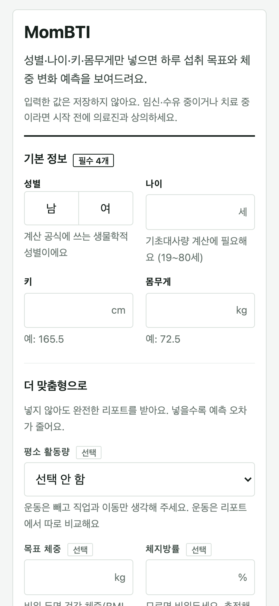
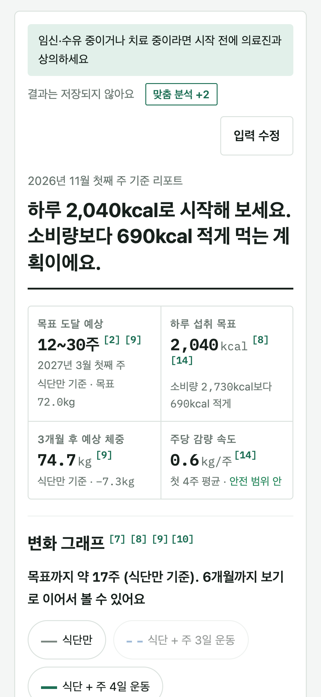
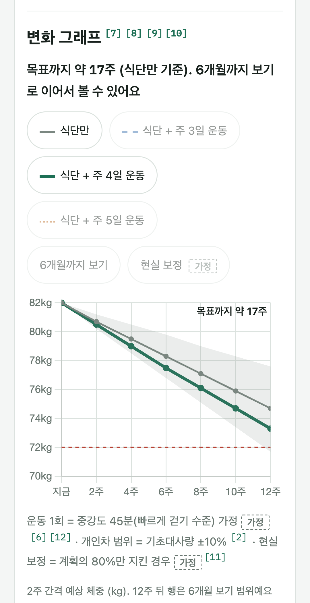
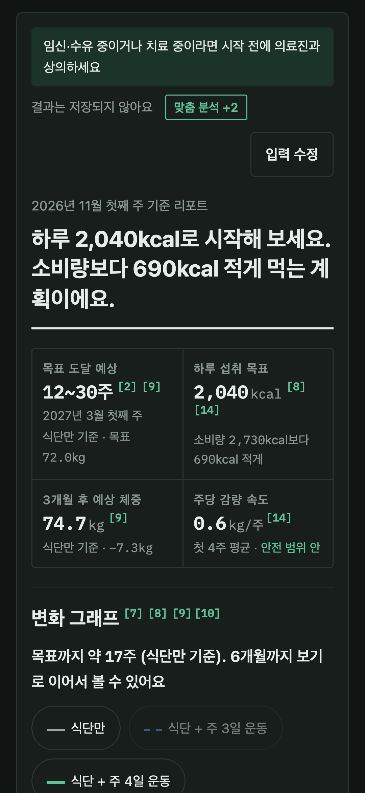
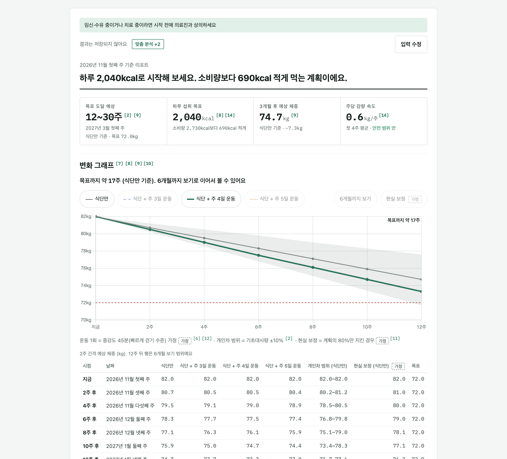

# MomBTI

성별·나이·키·몸무게 4가지만 입력하면 **하루에 얼마나 먹어야 하는지**와 **앞으로 내 몸이 어떻게 변할지**를 보여주는 다이어트 리포트 앱입니다.

막연한 다이어트 대신, 검증된 논문 공식과 공식 지침으로 계산한 숫자로 다이어트의 길을 알려주고 변화를 그래프로 보여줘서 끝까지 갈 수 있게 돕는 것이 목표입니다.

## 화면
| 입력 | 요약 | 변화 그래프 | 다크모드 |
|---|---|---|---|
|  |  |  |  |



## 핵심 기능
- **필수 4개만으로 완성된 리포트**: 비어 있는 선택 항목은 근거 있는 기본값으로 채우고 "추정"으로 표시
- **12주 변화 그래프**: 2주 간격, 6개월 보기 토글, 식단만 / 주 3·4·5일 운동 비교
- **범위로 보여주는 도달 시점**: 기초대사량 ±10% 개인차를 반영해 "12~30주"처럼 표시
- **식단**: 하루 섭취 kcal, 탄단지, 한식 끼니 예시와 편의점 대안
- **근거**: 모든 숫자에 논문 각주 (PMID)

## 기술 스택
Java 21 · Spring Boot 4.1 · Thymeleaf SSR · Chart.js 4.4 · JUnit 5 / AssertJ / MockMvc

## 왜 이렇게 만들었나
| 선택 | 이유 | 포기한 것 |
|---|---|---|
| 규칙 기반 계산 (LLM 미사용) | 같은 입력이면 항상 같은 결과, 숫자마다 출처 연결, TDD로 검증 가능 | 자유 텍스트 해석, 깊은 개인화 |
| Hall 동적 체중모델 | "7,700kcal = 1kg" 규칙은 장기 감량을 과대평가함 | 다른 계산기보다 느리게 빠지는 것처럼 보임 (FAQ로 설명) |
| 필수 입력 4개 + 기본값 추정 | 입력 부담을 줄이면서도 빈칸 없는 리포트 | 개인 오차 증가 → 범위 표기로 보완 |
| 저장·로그인 없음 | 건강 정보는 민감정보, 저장하지 않으면 유출도 없음 | 다시 보기, 공유 |
| SSR + 표 우선, 차트는 덧붙임 | JS가 꺼져도 정보 손실 없음, 계산과 화면이 어긋나지 않음 | SPA 수준의 상호작용 |
| 모바일 WebView 기준 (GET 리포트, 로컬 자산) | 앱 뒤로 가기, 오프라인, 노치 대응 | 입력값이 앱 방문 기록 URL에 남음 (외부 전송은 차단) |

자세한 개발 과정과 결정 근거는 [포트폴리오](PORTFOLIO.md)와 [ADR](docs/ADR.md)에 있습니다.

## 실행
```bash
./gradlew bootRun   # http://localhost:8080
./gradlew test      # 테스트 300개
```
